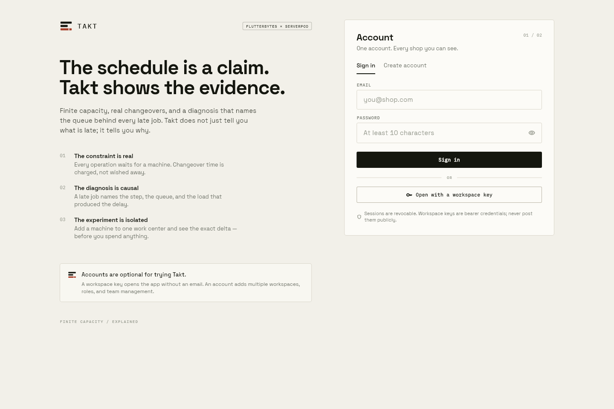
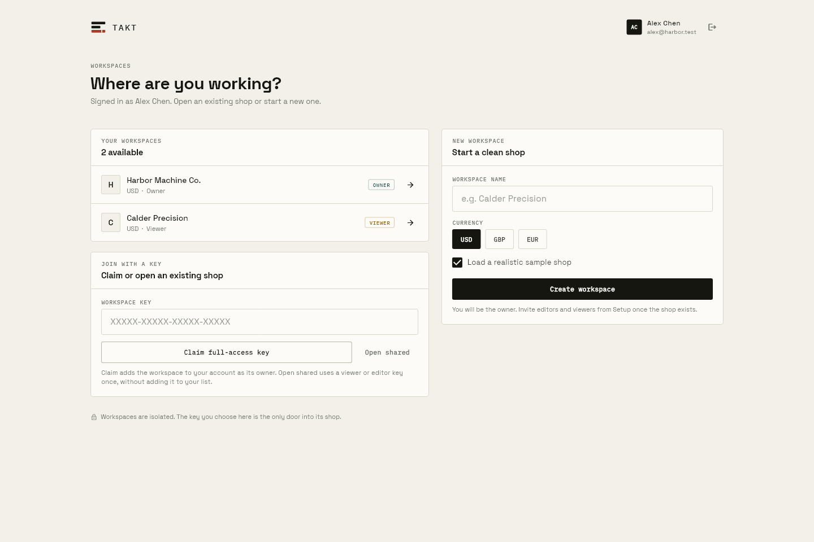
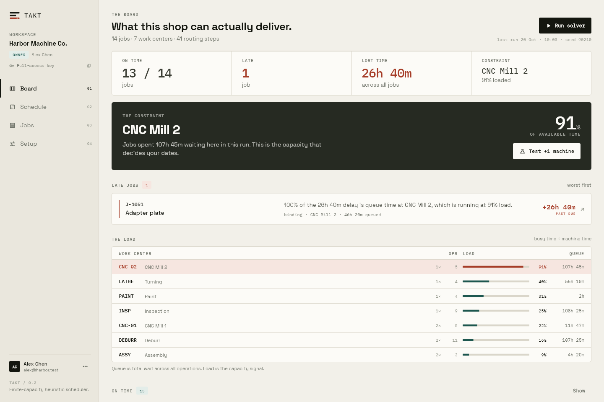
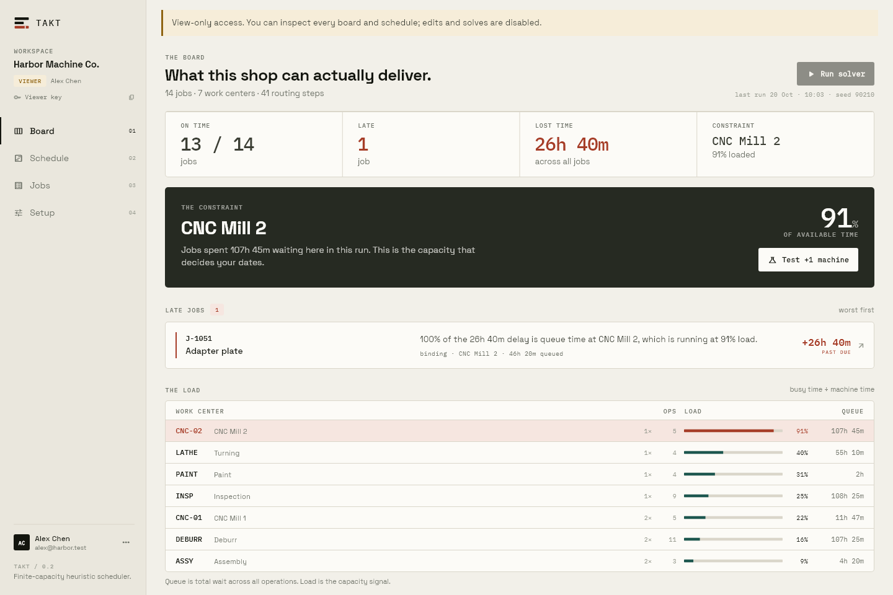

# Takt

**The scheduler that tells you why you’re late.**

Takt is an explainable finite-capacity scheduler for high-mix, low-volume job
shops. It builds a real schedule against machines, routings, release dates,
due dates, priorities, and changeovers — then explains each late job in plain
language and tells you which capacity decision would recover the lost time.

Built with **Flutter**, **Serverpod**, and an embedded PostgreSQL database.

| Account front door | Choose a workspace |
| --- | --- |
|  |  |

| Diagnosis-first board | Read-only viewer |
| --- | --- |
|  |  |

## Why Takt

Most shop tools show you a calendar full of bars. A red bar is not a reason.
Takt is built around the question a shop owner actually asks:

> “We’re going to miss this job. What is making us late, and what can we change?”

Takt answers with a causal chain: the job, how many minutes it is late, the
operation that waited longest, the work center where it waited, that work
center’s utilization, and the share of the delay attributable to queue time.
It then lets you test an extra machine on the bottleneck with a like-for-like
what-if run.

The product is deliberately not another full ERP or MES. Its wedge is the
capacity decision and its explanation, not quoting, purchasing, accounting, or
shop-floor data collection.

## What is implemented

### Scheduling and diagnosis

- Jobs are chains of operations with release dates, due dates, priorities, and
  setup/run minutes.
- Work centers contain one or more identical parallel machines and charge a
  flat changeover when a machine switches jobs.
- Continuous-time, finite-capacity list scheduling with EDD, priority, SPT, and
  slack dispatch rules, followed by seeded simulated annealing over the
  dispatch order.
- Every run records its seed, objective, makespan, on-time/tardy counts,
  total tardiness, bottleneck work center, and utilization. The same seed and
  inputs produce an identical schedule.
- Diagnosis emits a per-job explanation and operation chain. The board ranks
  late jobs first and names the binding queue.
- What-if re-solves the baseline and an extra-machine scenario with the same
  seed, then reports minutes saved and late jobs cleared.
- Run history is persisted and visible in the app.

### Accounts and collaboration

- Email/password registration and sign-in with Argon2id password hashes
  (19 MiB, two passes) in an isolate so logins do not block the server.
- 30-day revocable sessions. Only SHA-256 token digests are stored; the raw
  token never touches the database.
- One account can own or join many workspaces, switch between them, and retain
  the last-opened workspace between visits.
- Workspace membership roles enforced on the server:
  - **Owner** — full control, team management, and the full-access key.
  - **Editor** — reads and writes jobs, work centers, and schedules; cannot
    manage people.
  - **Viewer** — reads the board, schedule, history, jobs, and what-if; all
    writes and solver runs are rejected server-side.
- Each member receives a scoped workspace key. Keys are bearer credentials for
  data calls, separate from the account session.
- Owner UI for inviting existing accounts, copying scoped keys, changing roles,
  and removing access. Removal revokes the member key immediately.
- Guest access with a workspace key remains supported, so a link can open a
  shop without forcing account creation.
- Password change revokes every other session while keeping the current one.
- The UI is role-aware: write controls disappear, a read-only banner appears,
  and the People panel reflects the caller’s authority.

### Operations and UX

- Diagnosis-first board with late-job cards, bottleneck callout, queue
  attribution, and one-tap what-if.
- Gantt-style schedule by work center and machine.
- Job list with search by code/title/customer, status filters, and **Copy CSV**
  for the currently visible jobs.
- Setup for shop identity, currency, work centers, people, account, and
  session.
- Responsive layouts for wide desktop and phone widths; keyboard-friendly forms
  and visible focus states.
- Loading, empty, error, success, offline/retry, and read-only states.
- Distinctive drafting-sheet design language: Space Grotesk, IBM Plex Mono,
  paper/graphite/teal/oxide palette, technical annotations, and a custom mark.
- Generated visual goldens cover desktop, phone, auth, picker, viewer, and
  setup screens.

## Architecture

```text
takt_flutter/             Flutter client
  lib/screens/            Auth, picker, shell, board, schedule, jobs, setup
  lib/state/app_state.dart Session, workspace credential, role, app data
  test/golden_test.dart   Fixture-driven visual tests
takt_client/              Generated Serverpod protocol client
takt_server/              Serverpod API
  lib/src/auth/           Passwords, sessions, accounts, workspaces
  lib/src/access/         Scoped-key resolution and role enforcement
  lib/src/solver/         Pure scheduler and diagnosis
  lib/src/services/       Persistence, demo data, planning
  lib/src/endpoints/      Auth, workspace, shop, work center, job, schedule
  migrations/             PostgreSQL migrations, including auth tables
docs/                     Product, verification, and visual assets
```

### Auth and key model

```text
Account session (30 days)  ->  account identity, workspace list, team actions
Workspace key (scoped)     ->  shop data and solver calls
Owner full-access key      ->  the shop's original key; bypasses role limits
Member key                 ->  carries owner-assigned editor or viewer role
```

Sessions and workspace keys are deliberately separate. Signing out of an
account revokes that session but does not revoke workspace keys. Removing a
member revokes that member's key. The owner's original key is never returned
to a member; `Shop.accessKey` is blanked for non-owner callers and members see
other members' keys redacted.

Passwords are validated at 10–128 characters. Emails are normalized to
lowercase. Unknown-email login attempts still perform one Argon2 derivation to
reduce timing differences. A small in-process throttle blocks an email after
five failed attempts in ten minutes.

## Run it locally

### Prerequisites

- Flutter 3.41+ / Dart 3.11+ (the project SDK constraint is `^3.10.3`)
- Serverpod CLI `4.0.0-beta.4`
- No Docker is needed for development or tests; Serverpod manages an embedded
  PostgreSQL instance.

### Start the app

```bash
cd takt_server
dart pub get
serverpod start
```

`serverpod start` applies the migration, starts the API on `8080`, and launches
the Flutter app configured under `flutter_apps` (or press `Ctrl+R`). The
development database and socket live under `takt_server/.serverpod/`; the
development password file is `takt_server/config/passwords.yaml` and is
git-ignored.

To build and serve the web client manually:

```bash
cd takt_flutter
flutter pub get
flutter build web --release
python -m http.server 8090 --bind 127.0.0.1 --directory build/web
```

The release app expects the API at the URL in `takt_flutter/assets/config.json`.
For a local run the web build is served at `http://127.0.0.1:8090` and the API
at `http://localhost:8080`.

### First use

1. Create an account, or choose **Open with a workspace key** on the auth screen.
2. A new account lands on the workspace picker. Create a workspace and leave
   **Load the sample shop** on to get seven work centers and fourteen jobs.
3. Open the workspace, run the solver, and inspect the late-job diagnosis.
4. In Setup → People, invite a second existing account as an editor or viewer.
   Copy the scoped key from the confirmation dialog or the member row.
5. Sign in as that person, or open the scoped key as a guest, to see role-aware
   controls and server-enforced permissions.

For the local development database created during the build, the original
demo workspace can be opened with the guest key supplied in the hand-off
message. Keys are bearer credentials: do not post them publicly.

## Tests and checks

```bash
cd takt_server
dart analyze --fatal-infos
dart format --output=none --set-exit-if-changed lib test
dart test

cd ../takt_flutter
flutter analyze --no-pub
dart format --output=none --set-exit-if-changed lib test
flutter test --no-pub
flutter build web --release
```

Latest results are recorded in [docs/VERIFICATION.md](docs/VERIFICATION.md).

## Security and operational limits

Read these before exposing Takt beyond a local demo.

- There is **no email verification or password reset**. An invitation targets an
  existing account; someone could register an invited email first. Verify
  identity out of band.
- Workspace keys are bearer credentials and are stored as plaintext so an owner
  can retrieve and share them. Session tokens are hashed, but shop/member keys
  are not. Treat a database compromise as a full workspace-key compromise.
- There is **no key-rotation endpoint or UI**. To rotate a member key, remove
  the member and invite them again. Rotating the owner key requires a server
  operation or recreating the workspace.
- Logout revokes sessions only, not workspace keys. A copied scoped key keeps
  working until the member is removed or the database changes.
- The owner's full-access key bypasses roles by design. Never send it to a
  viewer or use it as a public share link; use scoped member keys.
- The login throttle is in-process and resets on restart. It is not a
  distributed rate limiter.
- Sessions are stored in the platform's `SharedPreferences` on the client, not
  a hardware-backed secure store.
- There is one active workspace per client session. Multiple workspace tabs are
  not synchronized.
- No audit log, ownership transfer, workspace deletion UI, SSO, or SCIM.
- No email, push, or SMS notifications.
- Scheduling is heuristic, not optimal or exact. It assumes deterministic
  processing times, flat changeovers, no shifts/calendars, no operators, no
  material availability, no batching, no preemption, and no machine downtime.
  It is a planning aid, not a promise of delivery.
- Serverpod Cloud deployment was not performed in this build and still needs
  the user's cloud login. Local development and the release web build are
  verified.

## Deployment notes

- Set real database and API secrets in `takt_server/config/` for staging and
  production; never reuse the development credentials.
- Apply migrations before starting a production server.
- Put the API behind TLS and a reverse proxy. Restrict CORS and network access
  to the shops that should reach it.
- Replace the local demo key and any test accounts before a public launch.
- Serverpod Cloud requires an authenticated `serverpod cloud` login; confirm the
  target project and secrets before deploying. See the Serverpod documentation
  for the current beta deployment flow.
- If the web app is hosted separately from the API, update
  `takt_flutter/assets/config.json` and rebuild.

## Product thinking and evidence

See [PRODUCT.md](PRODUCT.md) for the positioning, competitor scan with dated
public sources, assumptions separated from verified facts, personas, workflow,
and design rationale.

## License and provenance

This is a hackathon project. The sample shop is fictional. No customer data is
included. Third-party product names are used for comparison only; see
`PRODUCT.md` for source links.
