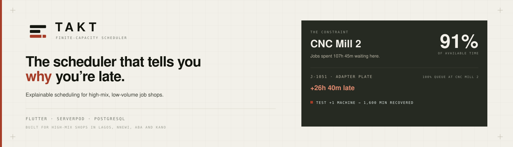
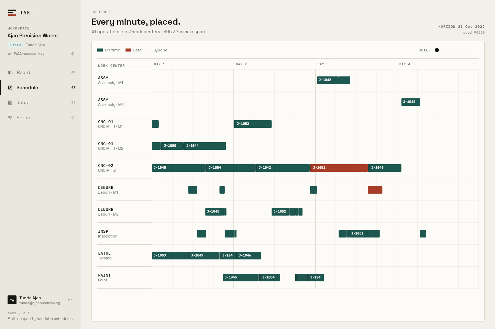
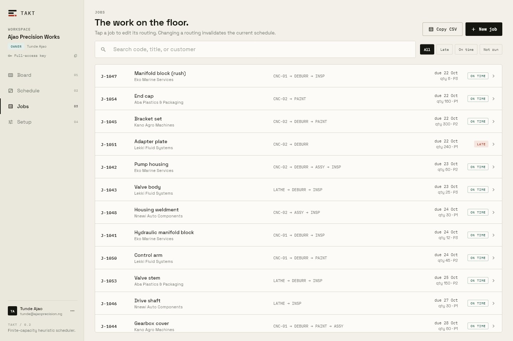
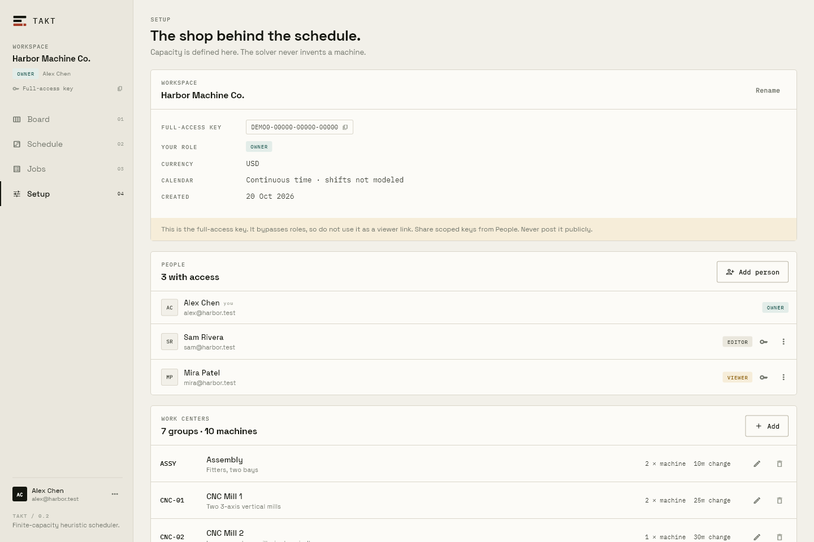
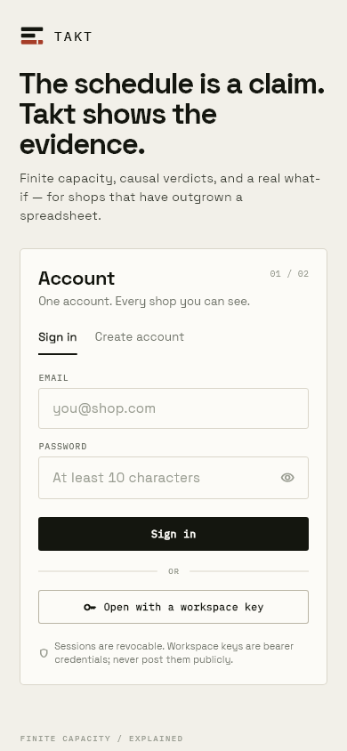
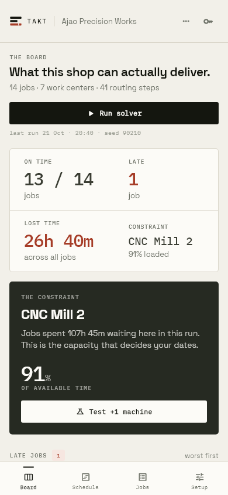
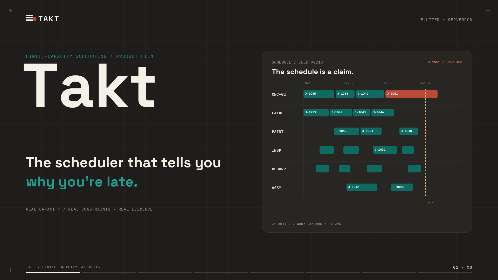
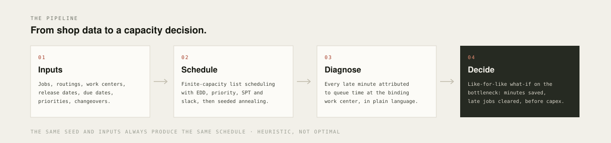

<div align="center">
  

  <h1>Takt</h1>

  <p><strong>The scheduler that tells you why you&rsquo;re late.</strong></p>

  <p>Explainable finite-capacity scheduling for high-mix, low-volume job shops.</p>

  <p>
    <a href="https://takt-demo.serverpod.space"></a>
    
    
    
    
    <a href="https://github.com/TanimowoObaloluwaDavid/takt/actions/workflows/tests.yml"></a>
  </p>

  <p>
    <a href="https://takt-demo.serverpod.space">Live demo</a> &nbsp;&middot;&nbsp;
    <a href="#see-it">Screens</a> &nbsp;&middot;&nbsp;
    <a href="video/takt-demo.mp4">Demo film</a> &nbsp;&middot;&nbsp;
    <a href="PRODUCT.md">Product notes</a> &nbsp;&middot;&nbsp;
    <a href="docs/VERIFICATION.md">Verification</a>
  </p>
</div>

<p align="center">
  
</p>

> **The demo in one sentence.** Ajao Precision Works in Lagos is 26h 40m late on
> J-1051; Takt traces every minute to the CNC-02 queue and shows that one extra
> machine clears the job and recovers 1,600 minutes — before the owner spends the
> capex.

Takt builds a real schedule against machines, routings, release dates, due
dates, priorities, and changeovers — then explains each late job in plain
language and tells you which capacity decision would recover the lost time.
Built with **Flutter**, **Serverpod**, and **PostgreSQL**.

---

## Contents

- [Why Takt](#why-takt)
- [See it](#see-it)
- [Try the demo](#try-the-demo)
- [How it works](#how-it-works)
- [What is implemented](#what-is-implemented)
- [Architecture](#architecture)
- [Run it locally](#run-it-locally)
- [Tests and checks](#tests-and-checks)
- [Security and operational limits](#security-and-operational-limits)
- [Deployment notes](#deployment-notes)
- [Product thinking](#product-thinking-and-evidence)
- [License and provenance](#license-and-provenance)

## Why Takt

Most shop tools show you a calendar full of bars. A red bar is not a reason.
Takt is built around the question a shop owner actually asks:

> “We’re going to miss this job. What is making us late, and what can we change?”

Takt answers with a causal chain: the job, how many minutes it is late, the
operation that waited longest, the work center where it waited, that work
center’s utilization, and the share of the delay attributable to queue time. It
then lets you test an extra machine on the bottleneck with a like-for-like
what-if run.

The product is deliberately not another full ERP or MES. Its wedge is the
capacity decision and its explanation, not quoting, purchasing, accounting, or
shop-floor data collection.

### Why Nigeria

Takt’s first design-partner market is Nigeria’s make-to-order manufacturing
belt: precision machining and fabrication around Lagos and Ogun, auto
components in Nnewi, plastics and light manufacturing in Aba, and agro-equipment
in Kano. These shops share the constraints Takt is built for: high mix, low
volume, imported machines and tooling, tight delivery promises, and a single
work center that can quietly become the queue for the whole shop.

| Context | Product consequence |
| --- | --- |
| NGN pricing, Lagos (WAT) demo workspace | The demo looks like the shop, not a US placeholder |
| A small shop needs an answer this week | Diagnosis before optimization; no 3–6 month ERP rollout |
| Another CNC machine is an FX decision | What-if before capex, with evidence the bottleneck is real |
| The person promising a date is not always the scheduler | Scoped viewer keys and server-enforced roles |

WAT is demo context, not a time-zone feature: the scheduler works in continuous
minutes and does not convert time zones or model shift calendars yet.

This is a pilot thesis, not traction. Ajao Precision Works and its people and
customers are fictional. Takt has no Nigerian customer, logo, testimonial,
revenue, or market-size claim. The next step is a design-partner pilot with 3–5
shops in one cluster, starting with one bottleneck and one week of real jobs,
and measuring whether the diagnosis changes a capacity decision.

## See it

Every screen below is a golden render from the real Flutter widgets against
captured demo data — not a stitched mockup. Click any image for the full-size
PNG.

<table>
  <tr>
    <td width="50%" align="center">
      <a href="docs/assets/board-wide.png"></a>
      <br />
      <sub><b>The board</b> — on-time count, the binding constraint, and each late job with its cause.</sub>
    </td>
    <td width="50%" align="center">
      <a href="docs/assets/schedule-wide.png"></a>
      <br />
      <sub><b>Schedule</b> — every operation placed by work center and machine, on a four-day horizon.</sub>
    </td>
  </tr>
  <tr>
    <td width="50%" align="center">
      <a href="docs/assets/jobs-wide.png"></a>
      <br />
      <sub><b>Jobs</b> — search by code, title or customer; filter by status; copy the visible list as CSV.</sub>
    </td>
    <td width="50%" align="center">
      <a href="docs/assets/setup-wide.png"></a>
      <br />
      <sub><b>Setup</b> — shop identity, currency, people and roles, and the work centers the solver is allowed to use.</sub>
    </td>
  </tr>
  <tr>
    <td width="50%" align="center">
      <a href="docs/assets/board-viewer.png"></a>
      <br />
      <sub><b>Viewer access</b> — the same board with writes disabled; the API rejects them too, not just the UI.</sub>
    </td>
    <td width="50%" align="center">
      <a href="docs/assets/picker-wide.png"></a>
      <br />
      <sub><b>Workspace picker</b> — one account, many shops; claim a full-access key or open a shared one.</sub>
    </td>
  </tr>
</table>

<table>
  <tr>
    <td width="28%" align="center">
      <a href="docs/assets/auth-phone.png"></a>
      <br />
      <sub><b>Phone:</b> sign in or open with a key</sub>
    </td>
    <td width="28%" align="center">
      <a href="docs/assets/board-phone.png"></a>
      <br />
      <sub><b>Phone:</b> the same diagnosis, stacked</sub>
    </td>
    <td width="44%" align="center">
      <a href="video/takt-demo.mp4"></a>
      <br />
      <sub><b>The 96-second film</b> — Nigerian English voiceover, captioned cuts, <a href="video/TRANSCRIPT.md">full transcript</a>.</sub>
    </td>
  </tr>
</table>

## Try the demo

The hosted demo at <https://takt-demo.serverpod.space> runs on Serverpod Cloud
with a managed PostgreSQL database and is seeded with the fictional Lagos shop
**Ajao Precision Works**: seven work centers, fourteen jobs, and customers such
as Eko Marine, Lekki Fluid, Kano Agro, Nnewi Auto, and Aba Plastics.

| Role | Sign in | What to look for |
| --- | --- | --- |
| **Owner** | `tunde@ajaoprecision.ng` / `Lagos.2026!` | Full board, setup, People, and the full-access key |
| **Editor** | `ngozi@ajaoprecision.ng` / `Lagos.2026!` | Can run the solver and edit; cannot manage people |
| **Viewer** | `amina@lekkifluid.ng` / `Lagos.2026!` | Read-only board and what-if; the API rejects writes |

Or skip the account entirely with the public read-only guest key:

```text
DRQFD-RVPK8-9Z6NJ-YRPX7
```

These are demo credentials for the fictional Ajao workspace and are safe to
publish: they only reach the seeded demo data. They are not production secrets
and are not reused anywhere else. **Do not put real shop data into the public
demo** — anyone reading this page can sign in as its owner.

Re-seed the Cloud workspace at any time with `dart run tool/seed_cloud.dart`
from `takt_client/`. The script is idempotent and prints the scoped keys.

## How it works

<p align="center">
  
</p>

The solver is a pure Dart package in `takt_server/lib/src/solver/`, separate from
persistence, so it can be tested without a database.

- **Jobs** are chains of operations with release dates, due dates, priorities,
  and setup/run minutes.
- **Work centers** hold one or more identical parallel machines and charge a
  flat changeover when a machine switches jobs.
- **Scheduling** is continuous-time, finite-capacity list scheduling with EDD,
  priority, SPT, and slack dispatch rules, followed by seeded simulated
  annealing over the dispatch order.
- **Reproducibility:** every run records its seed, objective, makespan,
  on-time/tardy counts, total tardiness, bottleneck work center, and
  utilization. The same seed and inputs produce an identical schedule.
- **Diagnosis** attributes late minutes to queue time at the binding work
  center and emits a per-job explanation and operation chain. The board ranks
  late jobs first and names the queue.
- **What-if** re-solves the baseline and an extra-machine scenario with the
  same seed, then reports minutes saved and late jobs cleared.

Useful rules of thumb baked into the demo: *J-1051* waits 46h 20m at
*CNC Mill 2*, which runs at 91% of available time; one extra machine clears the
job and recovers 1,600 minutes.

## What is implemented

<details open>
<summary><b>Scheduling and diagnosis</b></summary>

- Jobs are chains of operations with release dates, due dates, priorities, and
  setup/run minutes.
- Work centers contain one or more identical parallel machines and charge a
  flat changeover when a machine switches jobs.
- Continuous-time, finite-capacity list scheduling with EDD, priority, SPT, and
  slack dispatch rules, followed by seeded simulated annealing over the
  dispatch order.
- Every run records its seed, objective, makespan, on-time/tardy counts, total
  tardiness, bottleneck work center, and utilization. The same seed and inputs
  produce an identical schedule.
- Diagnosis emits a per-job explanation and operation chain. The board ranks
  late jobs first and names the binding queue.
- What-if re-solves the baseline and an extra-machine scenario with the same
  seed, then reports minutes saved and late jobs cleared.
- Run history is persisted and visible in the app.

</details>

<details>
<summary><b>Accounts and collaboration</b></summary>

- Email/password registration and sign-in with Argon2id password hashes
  (19 MiB, two passes) in an isolate so logins do not block the server.
- 30-day revocable sessions. Only SHA-256 token digests are stored; the raw
  token never touches the database.
- One account can own or join many workspaces, switch between them, and retain
  the last-opened workspace between visits.
- Workspace membership roles enforced on the server:
  - **Owner** — full control, team management, and the full-access key.
  - **Editor** — reads and writes jobs, work centers, and schedules; cannot
    manage people.
  - **Viewer** — reads the board, schedule, history, jobs, and what-if; all
    writes and solver runs are rejected server-side.
- Each member receives a scoped workspace key. Keys are bearer credentials for
  data calls, separate from the account session.
- Owner UI for inviting existing accounts, copying scoped keys, changing roles,
  and removing access. Removal revokes the member key immediately.
- Guest access with a workspace key remains supported, so a link can open a
  shop without forcing account creation.
- Password change revokes every other session while keeping the current one.
- The UI is role-aware: write controls disappear, a read-only banner appears,
  and the People panel reflects the caller’s authority.

</details>

<details>
<summary><b>Operations and interface</b></summary>

- Diagnosis-first board with late-job cards, bottleneck callout, queue
  attribution, and one-tap what-if.
- Gantt-style schedule by work center and machine.
- Job list with search by code/title/customer, status filters, and **Copy CSV**
  for the currently visible jobs.
- Setup for shop identity, currency, work centers, people, account, and
  session.
- Responsive layouts for wide desktop and phone widths; keyboard-friendly forms
  and visible focus states.
- Loading, empty, error, success, offline/retry, and read-only states.
- Distinctive drafting-sheet design language: Space Grotesk, IBM Plex Mono,
  paper/graphite/teal/oxide palette, technical annotations, and a custom mark.
- Generated visual goldens cover desktop, phone, auth, picker, viewer, and
  setup screens.

</details>

## Architecture

```text
takt_flutter/             Flutter client
  lib/screens/            Auth, picker, shell, board, schedule, jobs, setup
  lib/state/app_state.dart Session, workspace credential, role, app data
  test/golden_test.dart   Fixture-driven visual tests
takt_client/              Generated Serverpod protocol client
takt_server/              Serverpod API
  lib/src/auth/           Passwords, sessions, accounts, workspaces
  lib/src/access/         Scoped-key resolution and role enforcement
  lib/src/solver/         Pure scheduler and diagnosis
  lib/src/services/       Persistence, demo data, planning
  lib/src/endpoints/      Auth, workspace, shop, work center, job, schedule
  migrations/             PostgreSQL migrations, including auth tables
docs/                     Product, verification, and visual assets
```

### Auth and key model

```text
Account session (30 days)  ->  account identity, workspace list, team actions
Workspace key (scoped)     ->  shop data and solver calls
Owner full-access key      ->  the shop's original key; bypasses role limits
Member key                 ->  carries owner-assigned editor or viewer role
```

Sessions and workspace keys are deliberately separate. Signing out of an
account revokes that session but does not revoke workspace keys. Removing a
member revokes that member’s key. The owner’s original key is never returned to
a member; `Shop.accessKey` is blanked for non-owner callers and members see
other members’ keys redacted.

Passwords are validated at 10–128 characters. Emails are normalized to
lowercase. Unknown-email login attempts still perform one Argon2 derivation to
reduce timing differences. A small in-process throttle blocks an email after
five failed attempts in ten minutes.

### API integration

The supported integration is the generated `takt_client` package. Serverpod
maps endpoint methods to HTTP routes; raw HTTP calls pass every argument as a
query parameter, not as a JSON body. For example, a verified data call is:

```text
GET /shop/fetch?accessKey=XXXXX-XXXXX-XXXXX-XXXXX
```

| Endpoint group | Main methods | Credential |
| --- | --- | --- |
| `auth` | `register`, `login`, `me`, `logout`, `changePassword` | Session token for `me`/`logout`/`changePassword` |
| `workspace` | `create`, `claim`, `list`, `access`, `members`, `invite`, `setRole`, `removeMember` | Session token, except public `access(accessKey)` |
| `shop`, `workCenter`, `job`, `schedule` | Read/write shop data, run and inspect schedules | Workspace key (`accessKey`) |

`AuthResult.token` is the account session token. Workspace data calls use the
scoped `WorkspaceAccess.accessKey`, which is not interchangeable with the
session token. User-facing validation, auth, and permission failures are
serialized as HTTP 400 `TaktException` responses; read the `message` field and
show it as-is.

## Run it locally

### Prerequisites

- Flutter 3.41+ / Dart 3.11+ (the project SDK constraint is `^3.10.3`)
- Serverpod CLI `4.0.0-beta.4`
- No Docker is needed for development or tests; Serverpod manages an embedded
  PostgreSQL instance.

### Start the app

```bash
cd takt_server
dart pub get
serverpod start
```

`serverpod start` applies the migration, starts the API on `8080`, and launches
the Flutter app configured under `flutter_apps` (or press `Ctrl+R`). The
development database and socket live under `takt_server/.serverpod/`; the
development password file is `takt_server/config/passwords.yaml` and is
git-ignored.

To build and serve the web client manually:

```bash
cd takt_flutter
flutter pub get
flutter build web --release
python -m http.server 8090 --bind 127.0.0.1 --directory build/web
```

The release app expects the API at the URL in `takt_flutter/assets/config.json`.
For a local run the web build is served at `http://127.0.0.1:8090` and the API
at `http://localhost:8080`.

### First use

1. Create an account, or choose **Open with a workspace key** on the auth screen.
2. A new account lands on the workspace picker. Create a workspace and leave
   **Load the sample shop** on to get seven work centers and fourteen jobs.
3. Open the workspace, run the solver, and inspect the late-job diagnosis.
4. In Setup → People, invite a second existing account as an editor or viewer.
   Copy the scoped key from the confirmation dialog or the member row.
5. Sign in as that person, or open the scoped key as a guest, to see role-aware
   controls and server-enforced permissions.

The checked-in demo workspace is described in [Try the demo](#try-the-demo).
The sample loader creates the same Nigerian customer mix in any new workspace.
Treat a workspace key as a bearer credential: share scoped keys, never the
owner’s full-access key, and never post a real shop’s key in a public place.
The demo guest key above is the deliberate exception — read-only, and scoped to
fictional data.

## Tests and checks

| Suite | Command | Latest result |
| --- | --- | --- |
| Server analysis | `cd takt_server && dart analyze --fatal-infos` | Clean |
| Server formatting | `dart format --output=none --set-exit-if-changed lib test` | Clean |
| Server tests | `dart test` | **30 passed** |
| Flutter analysis | `cd takt_flutter && flutter analyze --no-pub` | Clean |
| Flutter formatting | `dart format --output=none --set-exit-if-changed lib test` | Clean |
| Flutter tests | `flutter test --no-pub` | **17 passed** |
| Web build | `flutter build web --release` | Success |

The server suite runs against Serverpod’s ephemeral embedded PostgreSQL and
exercises the real endpoints, not mocked services. The Flutter suite includes
fixture-driven golden tests for the board, schedule, jobs, setup, auth, picker,
viewer, phone widths, and the offline banner. Material Icons are loaded from
the Flutter SDK in the golden harness so the images render real glyphs.

CI runs analysis, formatting, both test suites, and a production web build on
every push to `main` and every pull request. The full record — including what
was **not** verified — is in [docs/VERIFICATION.md](docs/VERIFICATION.md).

## Security and operational limits

Read these before exposing Takt beyond a local demo.

- There is **no email verification or password reset**. An invitation targets an
  existing account; someone could register an invited email first. Verify
  identity out of band.
- Workspace keys are bearer credentials and are stored as plaintext so an owner
  can retrieve and share them. Session tokens are hashed, but shop/member keys
  are not. Treat a database compromise as a full workspace-key compromise.
- There is **no key-rotation endpoint or UI**. To rotate a member key, remove
  the member and invite them again. Rotating the owner key requires a server
  operation or recreating the workspace.
- Logout revokes sessions only, not workspace keys. A copied scoped key keeps
  working until the member is removed or the database changes.
- The owner’s full-access key bypasses roles by design. Never send it to a
  viewer or use it as a public share link; use scoped member keys.
- The login throttle is in-process and resets on restart. It is not a
  distributed rate limiter.
- Sessions are stored in the platform’s `SharedPreferences` on the client, not
  a hardware-backed secure store.
- There is one active workspace per client session. Multiple workspace tabs are
  not synchronized.
- No audit log, ownership transfer, workspace deletion UI, SSO, or SCIM.
- No email, push, or SMS notifications.
- Scheduling is heuristic, not optimal or exact. It assumes deterministic
  processing times, flat changeovers, no shifts/calendars, no operators, no
  material availability, no batching, no preemption, no time-zone conversion,
  and no machine downtime. It is a planning aid, not a promise of delivery.
- The hosted demo runs on Serverpod Cloud (project `takt-demo`). The deployment,
  HTTPS, managed database, and role checks are verified; Cloud load,
  backup/restore, custom domains, and native builds are not.

## Deployment notes

- Set real database and API secrets in `takt_server/config/` for staging and
  production; never reuse the development credentials.
- Apply migrations before starting a production server.
- Put the API behind TLS and a reverse proxy. Restrict CORS and network access
  to the shops that should reach it.
- Replace the demo key and any test accounts before using real shop data.
- The project is linked to Serverpod Cloud through `takt_server/scloud.yaml`
  (project `takt-demo`). Deploy from `takt_server/` with `scloud deploy` after
  `scloud auth login`.
- Build the hosted web bundle against the Cloud API before deploying:
  `flutter build web --release --base-href / --dart-define=SERVER_URL=https://takt-demo.api.serverpod.space`,
  then copy `takt_flutter/build/web` to `takt_server/web/app`.
- Seed or repair the hosted demo with `dart run tool/seed_cloud.dart` from
  `takt_client/`. The script is idempotent and prints the scoped keys.
- `SERVER_URL` (compile-time) overrides `takt_flutter/assets/config.json`, which
  keeps `http://localhost:8080` for local development.

## Demo film

The 96-second product film is in [`video/takt-demo.mp4`](video/takt-demo.mp4),
with a Nigerian English voiceover (`en-NG-AbeoNeural`) and an SRT caption track
([`video/takt-demo.srt`](video/takt-demo.srt)). Captioned and vertical cuts are
also ready: [`takt-demo-captioned.mp4`](video/takt-demo-captioned.mp4) (16:9,
burned-in captions) and [`takt-demo-vertical.mp4`](video/takt-demo-vertical.mp4)
(9:16, burned-in captions). The full narration and scene-by-scene proof are in
[`video/TRANSCRIPT.md`](video/TRANSCRIPT.md). Every screen is rendered from the
real Flutter widgets against captured demo data.

## Product thinking and evidence

See [PRODUCT.md](PRODUCT.md) for the positioning, competitor scan with dated
public sources, assumptions separated from verified facts, personas, workflow,
and design rationale.

## License and provenance

This is a hackathon project and no open-source license file is included, so
default copyright applies. Open an issue if you want to reuse or build on it.

Ajao Precision Works and the sample shop are fictional. No customer data is
included. Third-party product names are used for comparison only; see
`PRODUCT.md` for source links.
